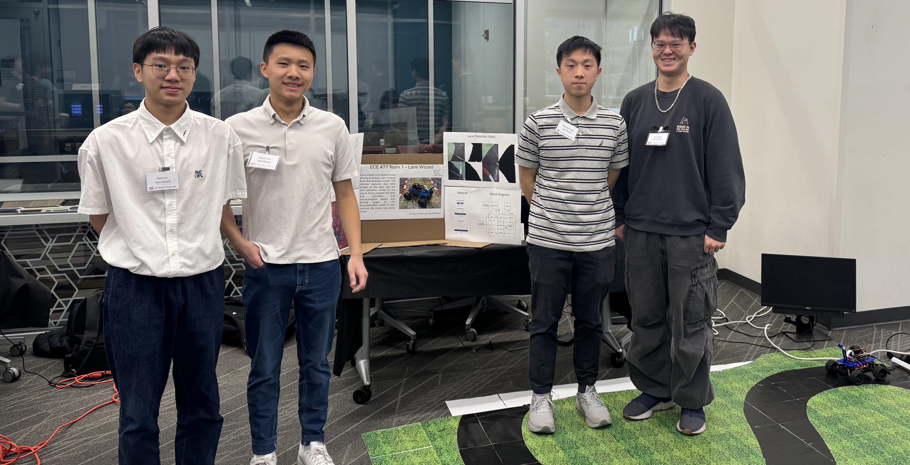
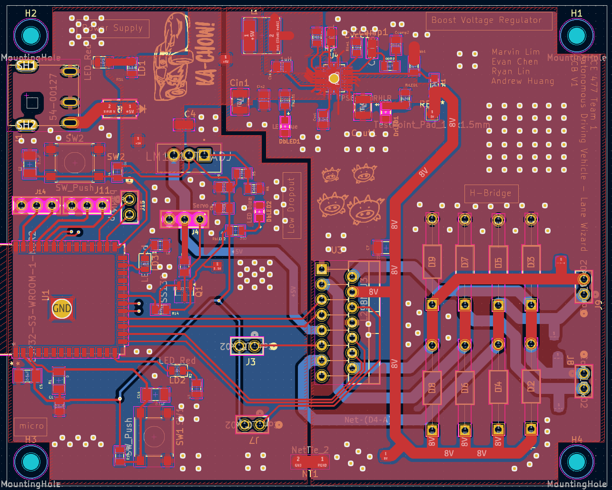
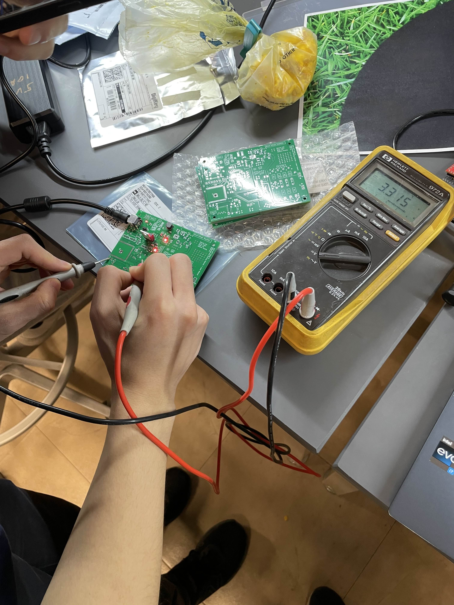

Lane Wizard is an autonomous driving prototype with custom built lane detection model. The camera captures real time images of the lane, and the lane detection model on the Jetson Nano predicts the lane and calculates and communicates speed and turning angle to the microcontroller, which in turn controls the motor and servo motor.

## System Pipeline

1.**Camera → Jetson Nano**

2.**ML inference**: RGB frame → resized input (e.g., 160×160) → lane mask prediction

3.**Control**: compute steering angle + speed from predicted lane

4.**Jetson → ESP32-S3 (UART)**

5.**Actuation**

- Motor speed via PWM/H-bridge
- Steering via servo PWM

## PSDRs (Project-Specific Design Requirements)

-**PSDR #1:** Boost DC regulator: 5V 6A → 8V (target 2A motor supply)

-**PSDR #2:** H-bridge control from ESP32-S3 PWM for motor direction/speed

-**PSDR #3:** Servo PWM steering with variable duty cycle

-**PSDR #4:** Jetson ↔ ESP32-S3 UART communication for speed/steering

-**PSDR #5:** Custom lane detection model producing a lane mask output (160×160)

Stretch goals included a custom discrete H-bridge design and a Bluetooth-based web controller. *Completed*

## My Contributions

- Hardware prototyping + integration across Jetson ↔ ESP32-S3 ↔ actuators
- Website + Bluetooth control interface for manual mode and debugging
- Microcontroller-side control logic (PWM + UART parsing)
- PCB design/assembly support and system bring-up/testing
- Lane detection model integration into end-to-end driving loop

## Media

-**Demo Video:**

  <videowidth="800"controls>

    <sourcesrc="/images/senior_design/Team 1 - Final Presentation Video.mp4"type="video/mp4">

</video>

