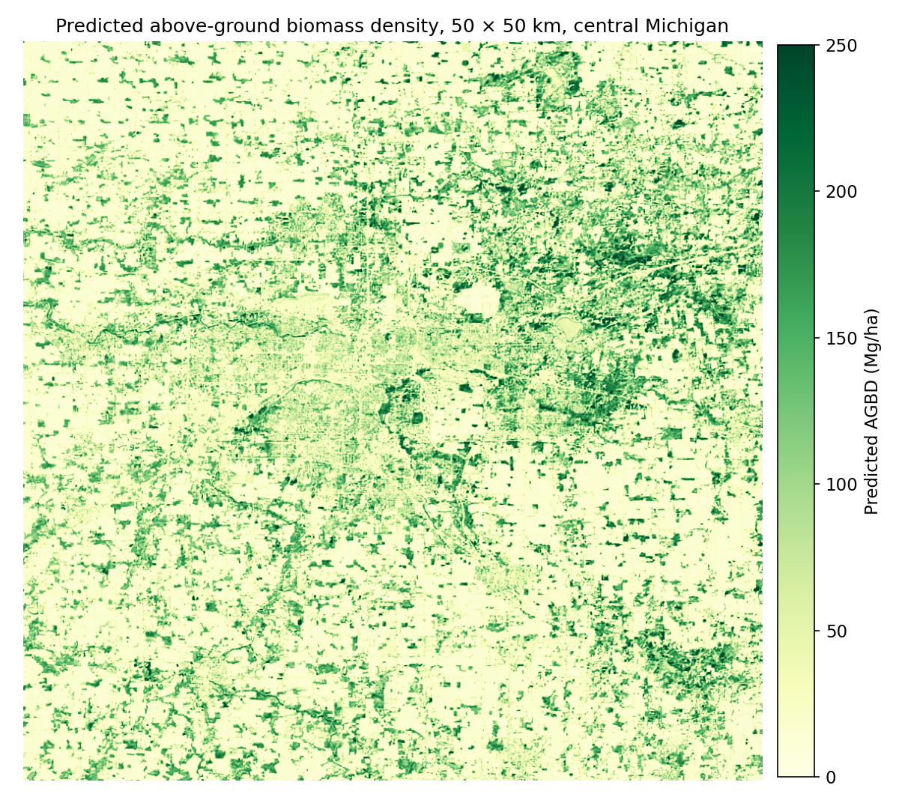
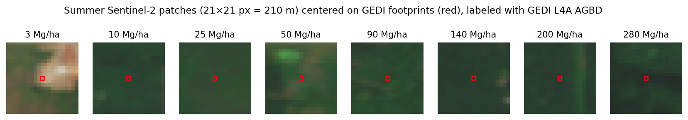
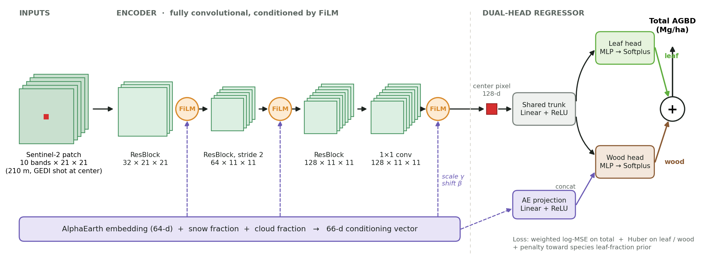
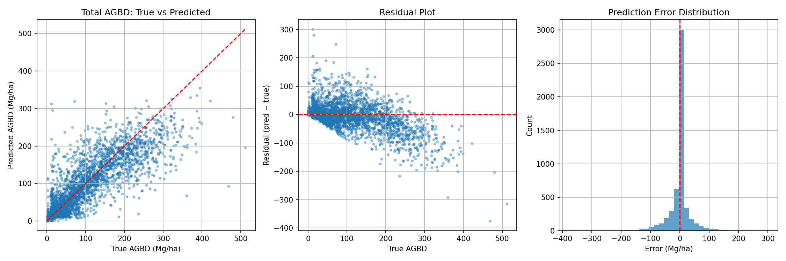
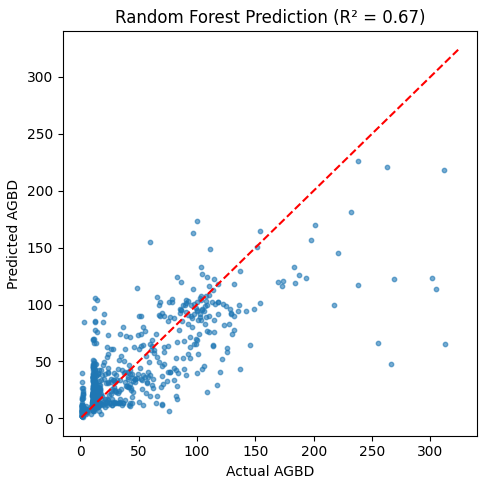
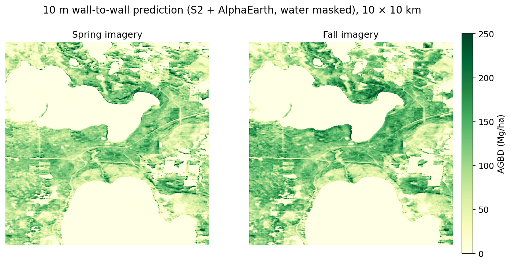
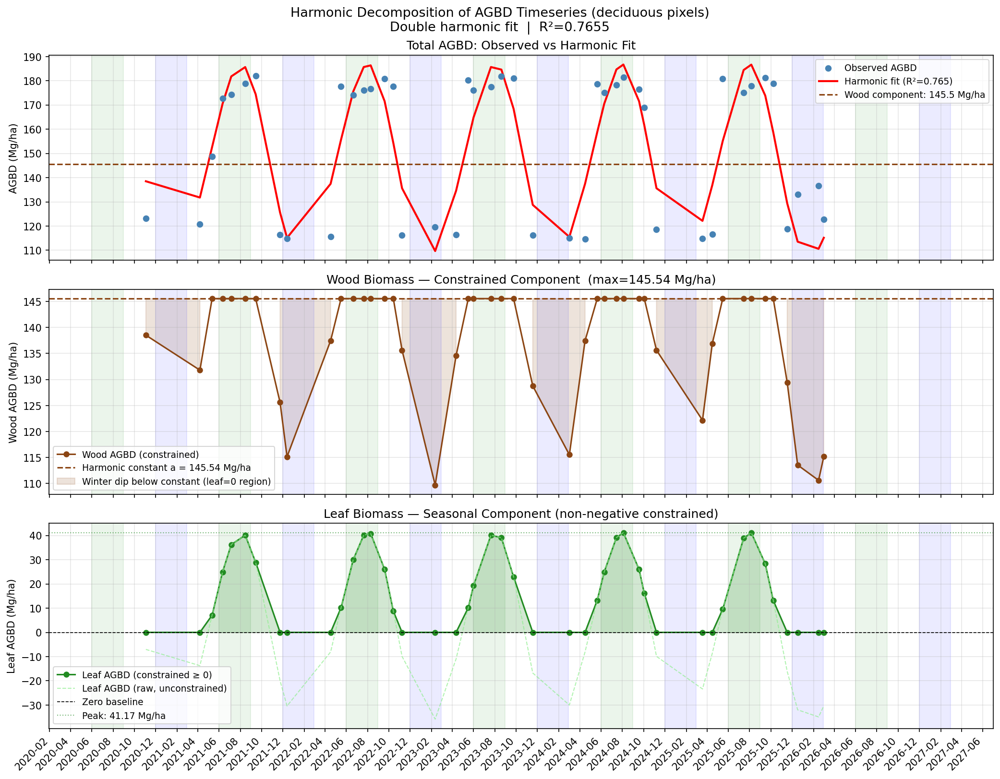
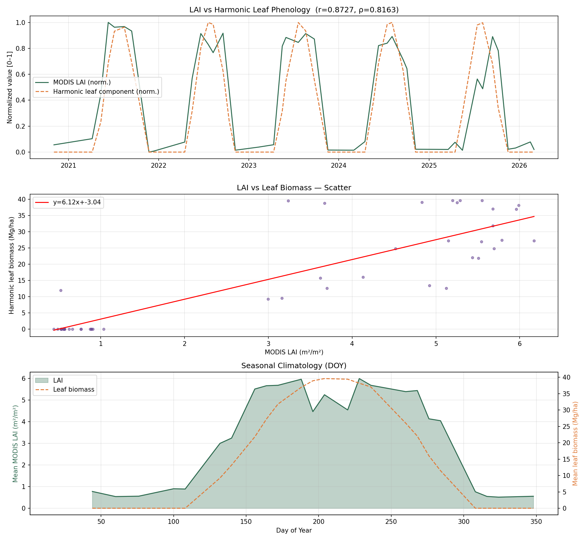
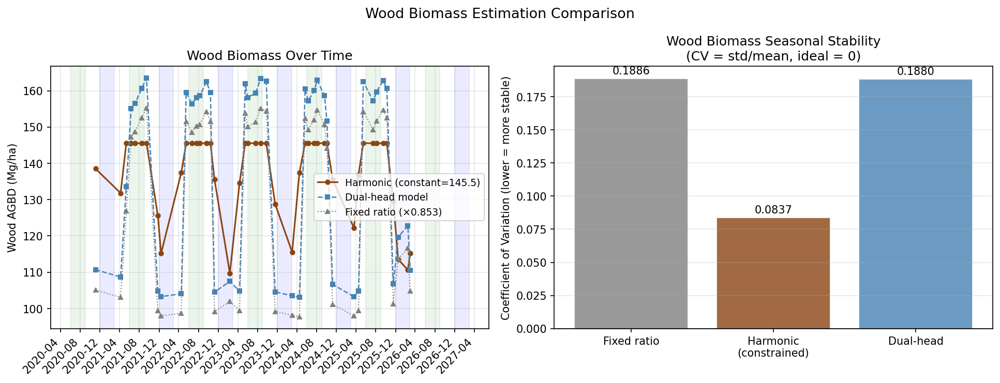

An end-to-end, multimodal pipeline that learns above-ground biomass density (AGBD) from sparse spaceborne lidar and turns it into wall-to-wall maps of Michigan. It fuses Sentinel-2 imagery and Google AlphaEarth embeddings, then splits biomass into leaf and wood using species-level allometry and phenology.

**Code & trained weights:** [github.com/andrewh1001/forest-biomass-mapping](https://github.com/andrewh1001/forest-biomass-mapping) · [How to get the data](https://github.com/andrewh1001/forest-biomass-mapping/blob/main/DATA.md)

**Tools:** PyTorch, CNN + FiLM conditioning, GEDI L4A lidar, Sentinel-2, AlphaEarth embeddings, rasterio / GDAL, Google Earth Engine, MODIS LAI

| GEDI footprints (labels) | Output resolution | Test R² (total AGBD) | RMSE vs. mean predictor |
|---|---|---|---|
| **61,246** | **10 m** | **0.78** | **−53%** (78.7 → 37.1 Mg/ha) |

*Figure 1. Predicted AGBD over a 50 × 50 km area of central Michigan. Woodlots, riparian corridors and larger forest blocks stand out against agricultural land and the urban core.*

## Overview

Forest biomass is central to carbon accounting, but measuring it directly is expensive. NASA's **GEDI** lidar on the International Space Station estimates biomass very well, but only in scattered 25 m footprints along orbit tracks, and most of the land is never sampled. Optical satellites like **Sentinel-2** see everything every few days, but can't directly measure vertical structure.

This project trains a model to predict GEDI's biomass from what Sentinel-2 and a learned Earth-observation embedding see around each footprint, then applies it to every 10 m pixel to produce continuous maps. A second stage asks a harder ecological question: *how much of that biomass is leaves, and how much is wood?*

## Data

| Source | Role | Details |
|---|---|---|
| GEDI L4A (v2.1) | Labels | Footprint AGBD for 2024–2025, quality-filtered, within 350 km of central Michigan |
| Sentinel-2 L2A | Primary input | 10 bands as 21 × 21 px patches (210 m) per footprint; SCL cloud/snow masks; spring, summer and fall composites |
| AlphaEarth Foundations | Context input | 64-d annual (2024) embedding per location from Google Earth Engine |
| NLCD 2024 | Land cover | Forest type (deciduous, evergreen, mixed) and water masking |
| USFS TreeMap 2022 | Leaf prior | Per-pixel FIA plot imputation of tree species and stem density |
| BAAD + Jenkins et al. | Leaf prior | Measured and allometric leaf-to-total mass ratios per species |
| MODIS MCD15A2H | Validation | 8-day leaf area index, 2020–2026 |

*Figure 2. Sentinel-2 patches centered on GEDI footprints. Above roughly 50 Mg/ha, summer canopies look nearly identical in optical imagery, which is why the model needs spatial context and the AlphaEarth embedding, not just pixel spectra.*

## Pipeline

1. **Ingest:** parse GEDI HDF5 beams, apply quality flags, download Sentinel-2 tiles and auxiliary rasters.
2. **Align:** reproject everything to equal-area EPSG:6933, mosaic tiles, snap AlphaEarth onto the S2 grid.
3. **Sample:** cut a 21 × 21 patch per footprint and drop no-data or cloudy patches.
4. **Train:** ResNet-style fully convolutional network with AlphaEarth FiLM conditioning and a weighted log-space loss.
5. **Map:** overlapping sliding-window inference over full scenes, written as cloud-masked 10 m GeoTIFFs.
6. **Prior:** combine TreeMap species with BAAD and Jenkins ratios to get a per-pixel leaf fraction.
7. **Time series:** predict 45 cloud-free dates from 2020–2026 and fit a two-term harmonic model.
8. **Validate:** compare the seasonal leaf signal against MODIS LAI.

## Model

The core network is a compact fully convolutional encoder over the Sentinel-2 patch. The AlphaEarth vector, plus per-patch snow and cloud fractions, conditions every stage through **FiLM** (feature-wise linear modulation), so the embedding shifts and scales the image features rather than being concatenated at the end. The FiLM layers are zero-initialized, so the network starts as a plain image model and learns how much to rely on the embedding. Biomass is read from the center pixel, which lets the same network run as a dense sliding-window map at inference time.

*Figure 3. AlphaEarth conditions the image encoder through FiLM. The center-pixel feature feeds separate leaf and wood heads, whose sum is total AGBD.*

**Training details:** AdamW (lr 1e-3, weight decay 3e-4) with reduce-on-plateau and gradient clipping. Because AGBD is heavily right-skewed (median 16, mean 63, max 575 Mg/ha), the loss is MSE in log space with extra weight on high-biomass samples. Hyperparameters were tuned with grid and Optuna searches.

## Results

| Model | RMSE (Mg/ha) | RMSE ÷ target std | R² |
|---|---|---|---|
| Predict the mean | 78.7 | 1.00 | 0.00 |
| Random forest (canopy height, SRTM, Daymet, NLCD)* | 23.6 | 0.58 | 0.67 |
| CNN, S2 + AlphaEarth, single head | 37.6–39.7 | 0.48–0.50 | 0.75–0.77 |
| **CNN, S2 + AlphaEarth, dual head** | **37.1** | **0.47** | **0.78** |

\*Scored on an earlier, smaller subset with a narrower biomass range (target std ≈ 41 vs. ≈ 79 Mg/ha), so compare R² or RMSE ÷ std rather than raw RMSE. On that scale the CNN's error is about 20% lower relative to the spread of the data.

*Figure 4. CNN on the held-out test set. Predictions follow the 1:1 line up to about 300 Mg/ha; very high-biomass stands are underestimated because optical signals saturate once the canopy closes.*

*Figure 5. Random-forest baseline, which underestimates strongly above about 100 Mg/ha.*

*Figure 6. The same 10 km area mapped from spring and fall imagery: forest structure stays consistent across seasons.*

## Separating Leaves from Wood

Leaves cycle carbon every year, while wood stores it for decades. I explored two complementary ways to separate them.

### Species-based leaf-fraction prior

For about 40 million forest pixels in Michigan, I looked up the TreeMap 2022 species list, weighted each species by stem density, and assigned a leaf-to-total mass ratio from BAAD where available and Jenkins et al. allometry otherwise.

| Forest type | Pixels | BAAD only | BAAD + Jenkins |
|---|---|---|---|
| Deciduous (NLCD 41) | 29.6 M | 0.150 | 0.084 ± 0.048 |
| Evergreen (NLCD 42) | 6.6 M | 0.230 | 0.124 ± 0.072 |
| Mixed (NLCD 43) | 4.3 M | 0.180 | 0.102 ± 0.060 |

Adding Jenkins allometry roughly halved the leaf fractions, since BAAD over-represents small and young trees.

### Phenology from a 6-year time series

I ran the trained model on 45 cloud-free Sentinel-2 dates (2020–2026) over a deciduous study area and fit a two-term harmonic regression (R² = 0.77). The constant term is read as the wood component (≈145 Mg/ha) and the seasonal oscillation as leaf phenology, peaking around late July.

*Figure 7. Harmonic decomposition of predicted AGBD into a constant wood component and a seasonal leaf component.*

Compared with **MODIS leaf area index** over the same area, the seasonal leaf signal tracks closely (Pearson r = 0.87, Spearman ρ = 0.82), with green-up, peak and senescence lining up.

*Figure 8. Validation against MODIS LAI: time series, scatter and seasonal climatology.*

*Figure 9. Wood biomass shouldn't change with the seasons. The harmonic decomposition is the most stable (CV 0.084); fixed-ratio and dual-head approaches inherit the full seasonal swing (CV ≈ 0.19).*

**What I learned:** the seasonal swing in predicted AGBD (about ±40 Mg/ha) is much larger than the foliage mass of a temperate forest, so the model partly responds to leaf-on/leaf-off reflectance changes. The LAI correlation confirms the signal is phenological, but it is better read as a canopy-greenness effect than literal leaf biomass.

## Next Steps

- **Spatial cross-validation** by held-out orbit tracks or spatial blocks, since nearby GEDI shots have overlapping patches.
- **Stratified metrics** for forest pixels and by biomass bin, since half of the samples are under 20 Mg/ha.
- **Ablations:** S2-only vs. S2 + AlphaEarth, single- vs. multi-season inputs.
- **Uncertainty:** propagate GEDI L4A standard errors and ensemble variance into the maps.

## Tech Stack

Python · PyTorch (CUDA) · rasterio · GDAL · geopandas · pyproj · h5py · xarray / rioxarray · scikit-learn · Optuna · NumPy / pandas · SciPy · Matplotlib · Google Earth Engine · NASA Earthdata / AppEEARS
