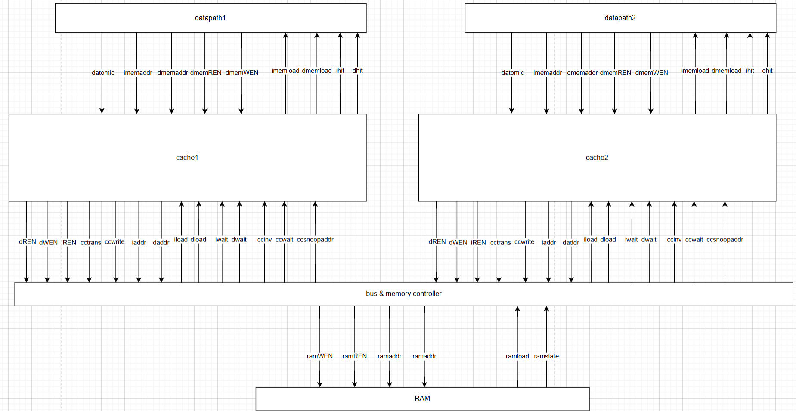
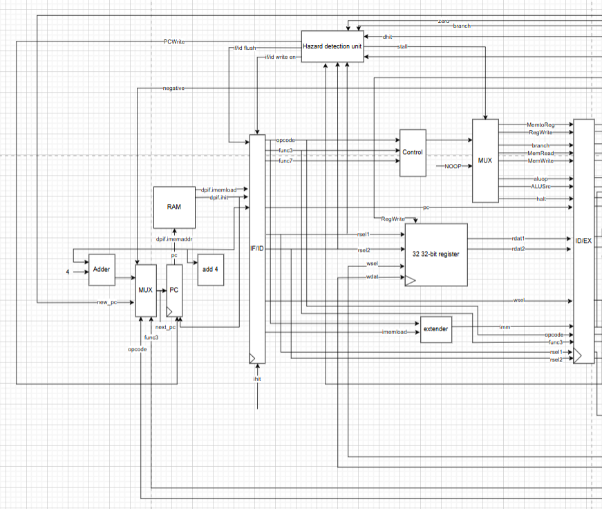
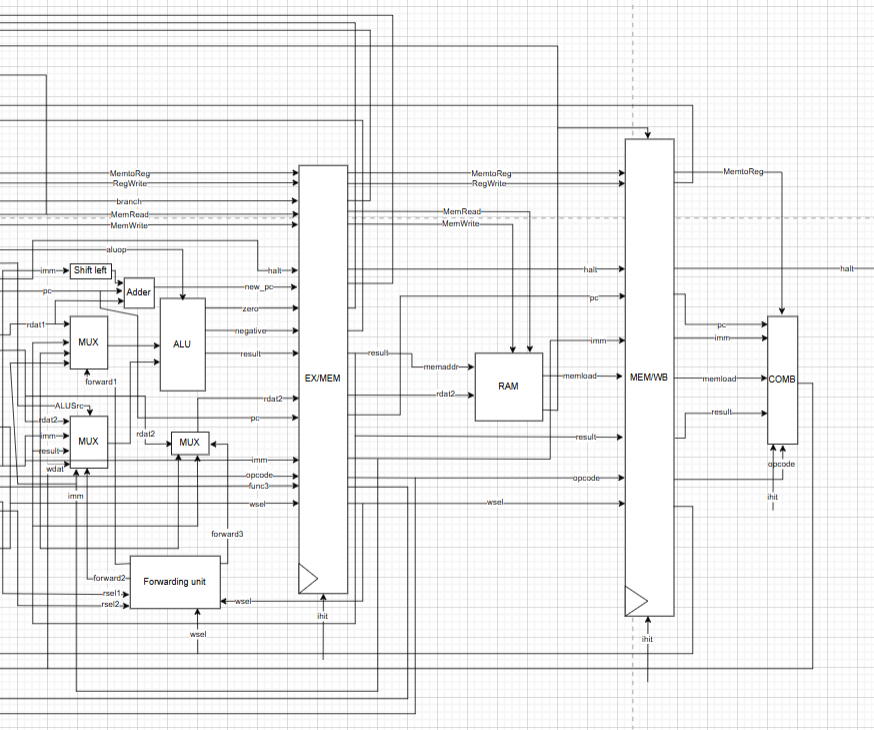
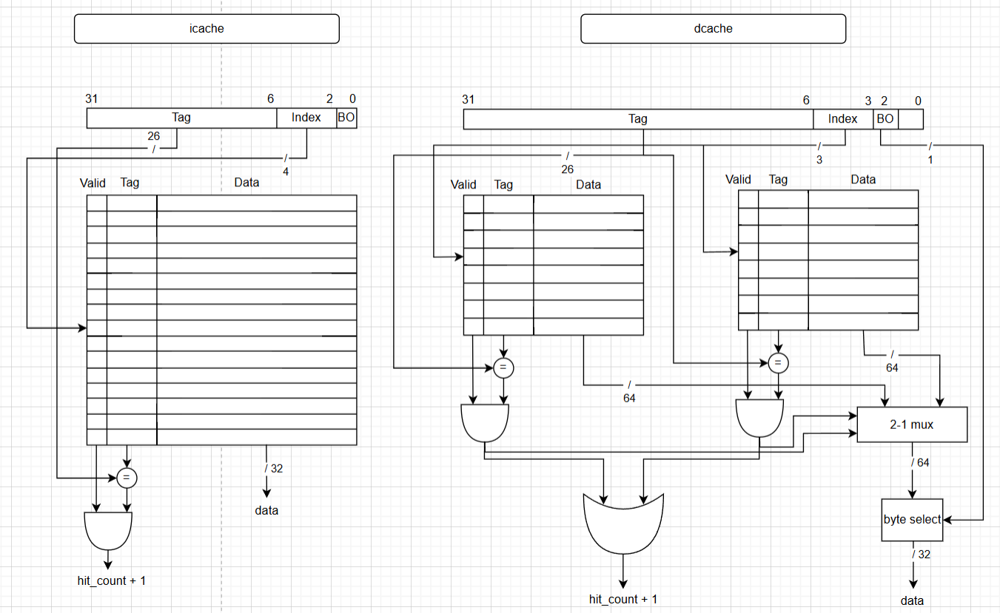
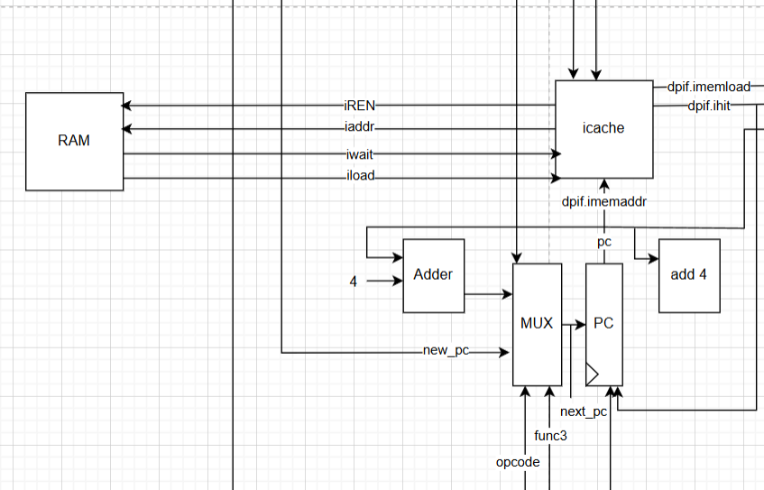
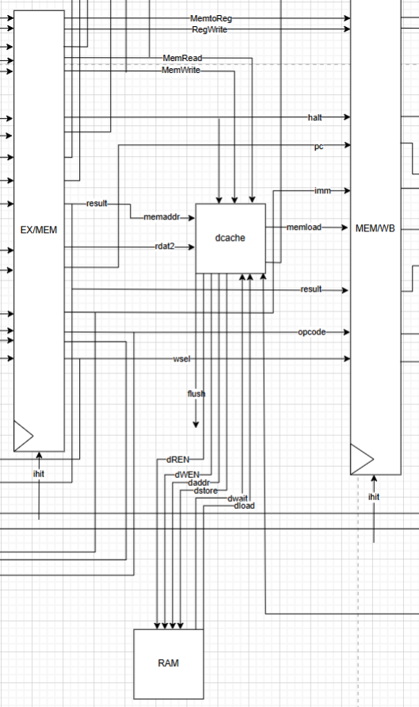
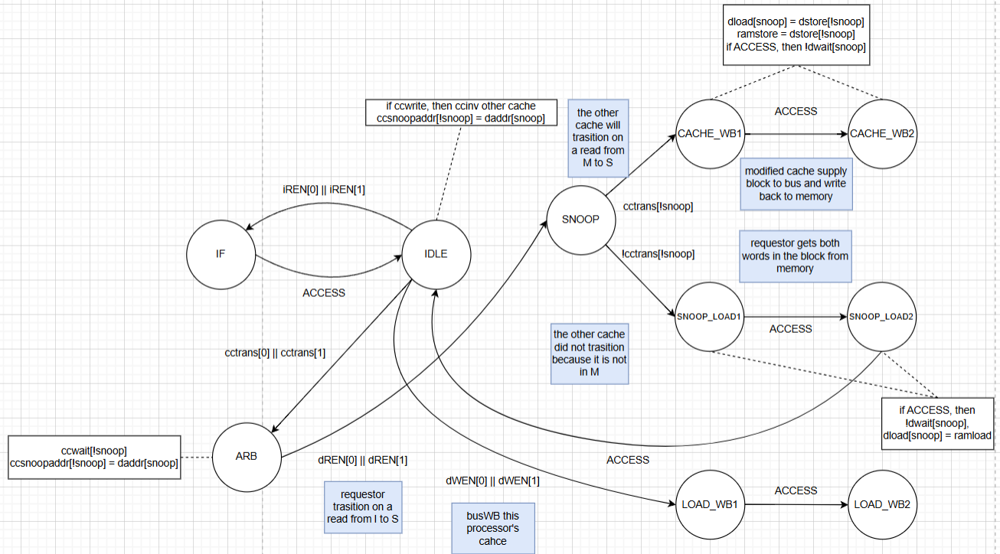
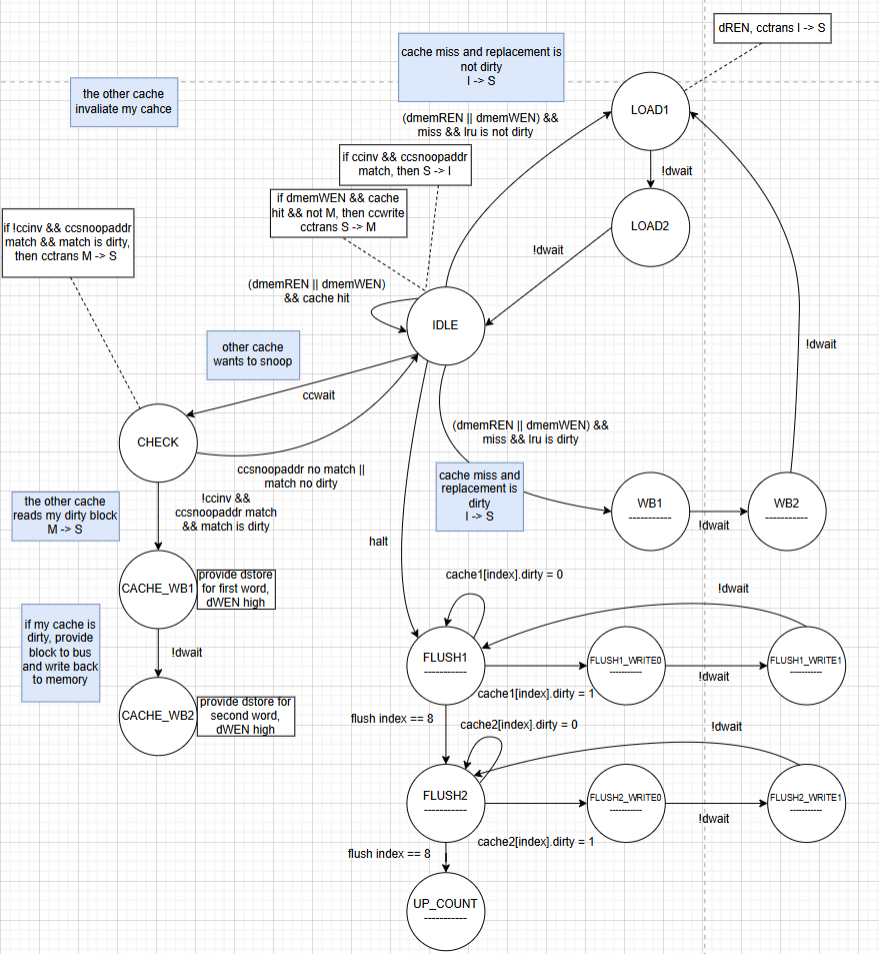

A RISC-V processor built up in stages on an FPGA, from a classic 5-stage pipeline, to a pipeline with instruction and data caches, to a dual-core design with snooping cache coherence. Each variant was synthesized and benchmarked to see how pipelining, caching and parallelism trade clock frequency, CPI and execution time against hardware cost.

**Tools:** SystemVerilog, FPGA synthesis and timing analysis, RISC-V assembly

| Cores | Pipeline stages | Fmax (cached pipeline) | CPI at 0-cycle memory | Dual-thread speedup |
|---|---|---|---|---|
| **2** | **5** | **up to 59.6 MHz** | **1.96** | **up to 1.43×** |

*Figure 1. The dual-core design: two datapaths, each with private caches, sharing RAM through a bus and memory controller that also carries coherence traffic.*

## Overview

A single-cycle processor is simple but its clock is limited by the slowest instruction. Pipelining raises the clock and overlaps instructions, but stalls whenever memory is slow. Caches hide most of that memory latency, and a second core can double throughput, as long as both cores agree on what memory holds.

This project builds each of those steps in hardware and measures what each one buys. The same mergesort benchmark runs on every design, under several simulated memory latencies, so the effect of each change can be isolated.

## Design progression

| Design | What it adds | What it costs |
|---|---|---|
| 5-stage pipeline | Overlapped IF / ID / EX / MEM / WB, forwarding and hazard detection | Pipeline registers, stall and flush logic |
| Pipeline + caches | Single-cycle memory access on a hit; CPI stays low as memory latency grows | Tag/data arrays, cache controller FSMs |
| Dual-core | Two hardware threads, shared memory, MSI coherence | Bus arbitration, snooping logic, synchronization overhead |

## 5-Stage Pipeline

The baseline is a classic **five-stage pipeline**: Instruction Fetch, Instruction Decode, Execute, Memory and Write-Back. A **forwarding unit** feeds ALU results from the EX/MEM and MEM/WB registers straight back into the ALU inputs, so most back-to-back dependencies don't stall. A **hazard detection unit** handles the rest: it stalls on load-use hazards and memory waits, and flushes IF/ID when a branch resolves in EX.

*Figure 2. Instruction Fetch and Decode: PC logic, register file, immediate extender, control unit and the hazard detection unit.*

*Figure 3. Execute, Memory and Write-Back, with the forwarding unit selecting ALU operands.*

## Cache Hierarchy

Instruction and data caches sit between the pipeline and memory, so a hit completes in a single cycle instead of waiting on RAM.

| Cache | Organization | Sets × ways | Block size | Policy |
|---|---|---|---|---|
| I-cache | Direct-mapped | 16 × 1 | 1 word (32 bit) | Read-only |
| D-cache | 2-way set associative | 8 × 2 | 2 words (64 bit) | Write-back, LRU replacement |

*Figure 4. Address breakdown and lookup logic. The I-cache splits the address into tag, 4-bit index and byte offset; the D-cache compares both ways in parallel and uses the block offset to select a word.*

*Figure 5. Instruction cache integration.*

{: style="display:block"}
*Figure 6. Data cache integration.*

## Multicore and Cache Coherence

The dual-core design puts **two identical cores**, each with private caches, on a shared bus. Coherence uses a **snooping MSI protocol**:

- **Read miss:** the requesting cache loads the block and moves it I → S. If the other cache holds that block modified, it supplies it over the bus, writes it back to memory and drops to S.
- **Write hit on a shared block:** the cache broadcasts an invalidate, the other copy goes S → I, and the writer moves to M.
- **Dirty eviction:** the victim block is written back (both words) before the new block is loaded.
- **Halt:** each cache flushes its dirty blocks to memory so the final memory image is correct.

The bus controller arbitrates between the two caches, forwards snoop addresses, and sequences two-word transfers between caches and RAM.

*Figure 7. Bus controller state machine: instruction fetch, arbitration, snooping, cache-to-cache transfer with write-back, and memory loads.*

*Figure 8. Data cache controller: hit handling, miss loads, dirty write-backs, snoop responses and the flush sequence on halt.*

## Evaluation

The benchmark is mergesort, compiled to RISC-V assembly and run on each design with memory latency set to 0, 2, 6 and 10 cycles. The multicore design was run both single-threaded and dual-threaded. Each run recorded:

- Maximum clock frequency (Fmax)
- Average clocks per instruction (CPI)
- Average latency per instruction and total execution time
- FPGA resource usage (registers and logic elements)

## Results

### Pipeline with caches

| Memory latency | CPU clock (MHz) | Executed cycles | Avg CPI | Avg latency / instr (ns) | Total exec time (ns) |
|---|---|---|---|---|---|
| 0 cycles | 53.57 | 21,233 | 1.96 | 0.183 | 198.18 |
| 2 cycles | 59.30 | 23,273 | 2.15 | 0.181 | 196.23 |
| 6 cycles | 54.87 | 27,349 | 2.53 | 0.230 | 249.22 |
| 10 cycles | 59.58 | 31,425 | 2.90 | 0.244 | 263.72 |

*Table 1. Going from 0 to 10 cycles of memory latency adds only about 48% more cycles, because most accesses hit in the cache.*

### Multicore

- Dual-threaded mergesort ran up to **1.43× faster** than on a single core.
- Single-threaded code ran slower on the multicore design, since it pays for bus arbitration and coherence without using the second core.
- The second core only pays off when the software has enough parallel work to split.

## Takeaways

- Caches matter more the slower memory gets: CPI rose from 1.96 to only 2.90 across a 10-cycle latency range.
- Multicore hardware is only as good as the parallelism in the software running on it.
- Every architectural feature has to be judged on both its speedup and its hardware cost, in clock frequency and in FPGA resources.

## Contributions

- Pipeline, cache and multicore implementation
- FPGA synthesis and performance evaluation
- Analysis of architectural tradeoffs across the designs
