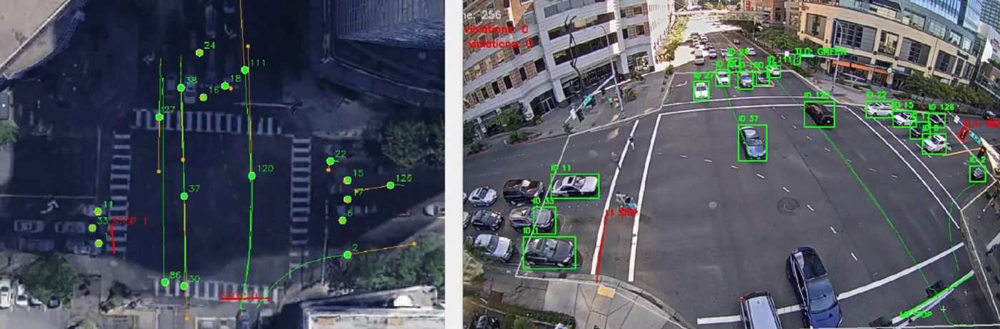
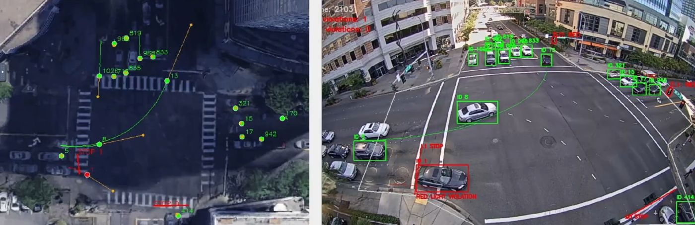
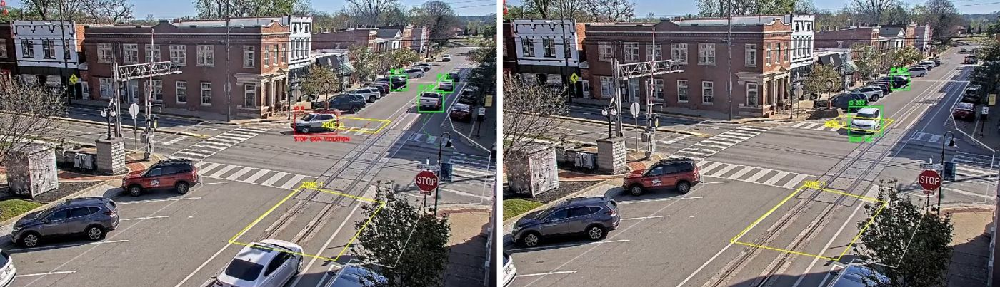

At least a third of U.S. traffic fatalities happen at intersections, yet violation enforcement still mostly relies on people reviewing camera footage. GeoVision is an end-to-end, user-configurable system that watches an intersection through one fixed camera and flags violations automatically. It detects and tracks vehicles, reads the traffic signals, and projects every vehicle onto a satellite bird's-eye view so it can reason about stop lines, stop zones and trajectories on the actual ground plane.

*EECS 504 (Computer Vision) course project at the University of Michigan, with Jinle Lin and Weirui Wan.*

**Code:** [github.com/andrewh1001/GeoVision](https://github.com/andrewh1001/GeoVision) · **Report:** [PDF](/files/GeoVision_report.pdf)

**Tools:** Python, Ultralytics YOLO12, ByteTrack, OpenCV, NumPy, RANSAC homography

| Training images | Test precision | Test recall | mAP@50 | mAP@50-95 |
|---|---|---|---|---|
| **2,100** | **80.2%** | **83.6%** | **84.9%** | **67.1%** |

## Demo

<iframe width="560" height="315" src="https://www.youtube-nocookie.com/embed/UXJ3qv2sZkI" title="GeoVision demo 1" loading="lazy" allow="accelerometer; encrypted-media; gyroscope; picture-in-picture; fullscreen" allowfullscreen></iframe>

*Demo 1. [Watch on YouTube](https://youtu.be/UXJ3qv2sZkI)*

<iframe width="560" height="315" src="https://www.youtube-nocookie.com/embed/J2aUTMPvk2s" title="GeoVision demo 2" loading="lazy" allow="accelerometer; encrypted-media; gyroscope; picture-in-picture; fullscreen" allowfullscreen></iframe>

*Demo 2. [Watch on YouTube](https://youtu.be/J2aUTMPvk2s)*

## What it detects

- **Red-light violations:** a vehicle crosses its lane's stop line while that lane's signal is red.
- **Stop-sign non-compliance:** a vehicle leaves a stop zone without ever coming to a full stop for at least half a second.
- **Near-collisions:** ground-plane trajectories are extrapolated about two seconds ahead, and a warning is raised when two predicted paths come within a set distance.

*Figure 1. Tracked vehicles with trails in the camera view (right) and their ground-projected trajectories, predicted paths and near-collision warnings on the satellite view (left).*

## Method

**Detection and tracking.** The detector is YOLO12-s, a single-stage anchor-free detector whose backbone uses attention to capture long-range spatial context. That matters here because vehicles at the far side of an intersection can be as small as 30 pixels wide, and often partly occluded. It was fine-tuned on 2,100 annotated intersection images (cars and buses) at 640 × 640. ByteTrack links detections across frames in two stages: high-confidence boxes are matched to existing tracks by IoU, then unmatched tracks get a second chance against low-confidence boxes. This keeps each vehicle's ID through brief occlusions, and that ID drives all the downstream violation logic.

**Traffic-signal state.** Each bulb is sampled in HSV, since hue is more robust to illumination changes than RGB. The active bulb is the brightest one whose mean hue falls in its expected range, falling back to the brightest bulb overall. A 10-frame majority vote removes single-frame errors at signal transitions.

**Homography calibration.** A 3 × 3 homography maps camera pixels onto the road plane in an overhead satellite image. It is estimated from user-picked point pairs with a Direct Linear Transform, using RANSAC to reject bad pairs. Vehicles are projected from the bottom-center of their box, since the flat-ground assumption breaks for the tops of tall vehicles.

**Violation logic.**
- *Stop lines:* the sign of the cross product between the stop-line segment and the vehicle position tells which side the vehicle is on. A sign change over the last five positions counts as a crossing, which tolerates frames where the tracker briefly loses the vehicle.
- *Stop zones:* a vehicle is stationary when the standard deviation of its position over a sliding window falls below a threshold. A continuous stationary run of at least 0.5 s means compliance. A short grace period after the vehicle leaves the zone stops tracker jitter at the boundary from triggering early judgements.
- *Near-collisions:* velocity is the mean frame-to-frame displacement on the ground plane, extrapolated linearly. Because the homography amplifies tracker jitter, satellite positions are smoothed with an exponential moving average.

*Figure 2. A red-light violation. The vehicle crosses the stop line while its signal is red, and its box turns red.*

*Figure 3. Stop zones (yellow). Left: a vehicle passes through without stopping and is flagged. Right: a vehicle stops and is marked compliant.*

## Prototype

The system is three Python tools:

| Tool | What it does |
|---|---|
| `define_region.py` | Annotate traffic-light housings and bulbs, stop lines, stop zones, stop signs and regions of interest |
| `calibrate_H.py` | Pick matching points in the camera frame and satellite image; computes the homography with RANSAC and shows per-point reprojection error |
| `run_detection.py` | Main pipeline: loads the calibration, pairs lanes with signals, runs the tracker, evaluates every violation rule, and renders annotated camera and satellite videos with live violation counts |

## Limitations

- ByteTrack ID switches during heavy occlusion can reset a vehicle's stop-zone timer, so it can exit without being flagged.
- Linear extrapolation predicts a turning car keeps going straight for a moment, which causes false near-collision warnings at the apex of a turn.
- Direct sunlight glare can desaturate bulbs below the HSV threshold.
- The 10-frame vote adds a short delay at signal changes, so a car that moves the instant the light turns green can be briefly mis-flagged.
- Stationarity is measured in image pixels, so it demands more stillness from vehicles near the camera than far ones. Measuring it on the ground plane would fix this.
- Detection generalizes best when the model is fine-tuned on some footage from the target intersection.

Because the system can produce false positives and raises privacy concerns, it is meant as a decision-support tool, with human review before any enforcement.
