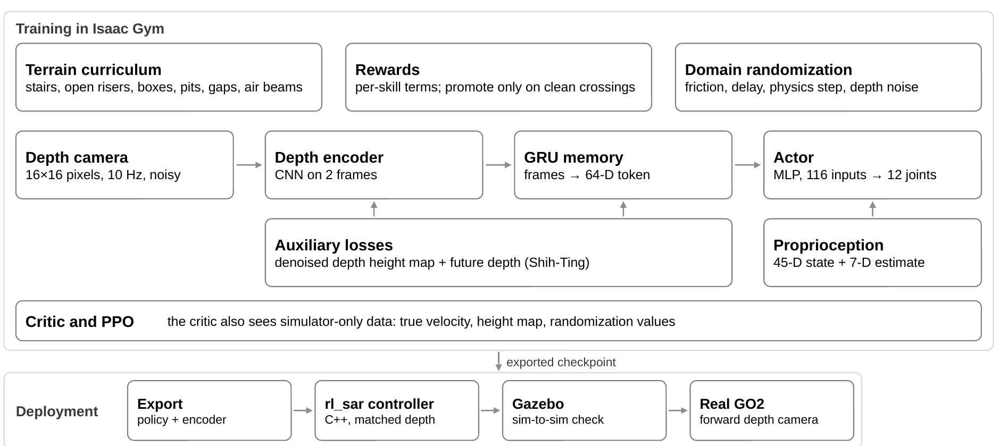
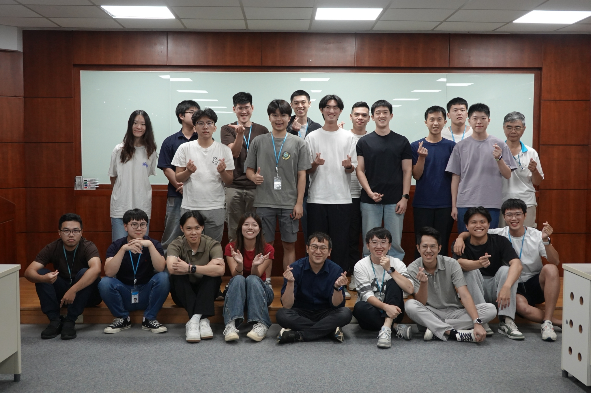
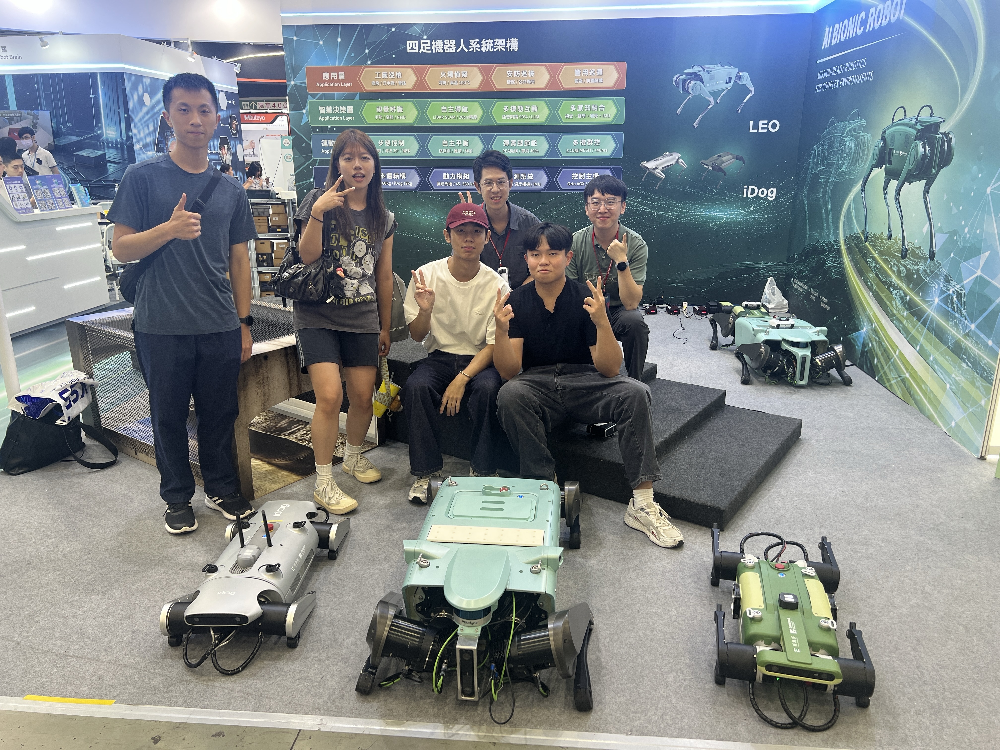

A reinforcement-learning locomotion policy for the Unitree Go2 quadruped. From one small forward depth camera (16 × 16 pixels) and its own joint sensors, the robot learns to climb stairs, jump onto and off a 40 cm box, leap gaps up to 0.9 m and cross narrow beams. The goal was to improve the Go2's real-world performance on tasks like stairs and obstacles, so every skill was trained in Isaac Gym, checked sim-to-sim in Gazebo through the robot's C++ controller, and then run on the real robot.

*Research internship at ITRI (Industrial Technology Research Institute), Taiwan, May to October 2026.*

**My role:** I built the training environment (procedural terrains, reward functions, curriculum and domain randomization for every skill) and the GRU memory module that carries terrain across frames. I also reworked the deployment pipeline: the existing sim-to-sim and real-robot code was written for another model, so I adapted the export, depth preprocessing and controller to this policy.

**Tools:** PyTorch, Isaac Gym, PPO, NVIDIA Warp ray casting, TorchScript, ROS 2 Humble, Gazebo, rl_sar, Docker, TensorBoard

| Real stairs                        | Box jump                                    | Approach yaw                          | Open-riser stairs                | Gap leap                              | Fall recovery                  |
| ---------------------------------- | ------------------------------------------- | ------------------------------------- | -------------------------------- | ------------------------------------- | ------------------------------ |
| **18 cm**                    | **40 cm**                             | **±20°**                      | **17 cm**                  | **80%**                         | **100%**                 |
| ascent and descent on the real Go2 | onto and off, in Gazebo and on the real Go2 | box mount with no steering correction | suspended 4 cm treads, in Gazebo | from 0.3%, on 0.1–0.9 m gaps (Isaac) | self-righting in 1.4 s (Isaac) |

## Videos

<figure><video controls muted loop playsinline preload="none" poster="/images/intern_itri/real_box_jump.jpg" src="/images/intern_itri/real_box_jump.mp4"></video><figcaption>Jumping onto and off a 40 cm box on the real Go2.</figcaption></figure>
<figure><video controls muted loop playsinline preload="none" poster="/images/intern_itri/real_stairs.jpg" src="/images/intern_itri/real_stairs.mp4"></video><figcaption>Stair ascent and descent on the real Go2.</figcaption></figure>
<figure><video controls muted loop playsinline preload="none" poster="/images/intern_itri/gazebo_open_riser.jpg" src="/images/intern_itri/gazebo_open_riser.mp4"></video><figcaption>17 cm open-riser stairs with 4 cm treads in Gazebo.</figcaption></figure>
<figure><video controls muted loop playsinline preload="none" poster="/images/intern_itri/gazebo_gap_60cm.jpg" src="/images/intern_itri/gazebo_gap_60cm.mp4"></video><figcaption>Leaping a 60 cm gap in Gazebo.</figcaption></figure>
<figure><video controls muted loop playsinline preload="none" poster="/images/intern_itri/gazebo_air_beam.jpg" src="/images/intern_itri/gazebo_air_beam.mp4"></video><figcaption>Air beams with 20 cm gaps in Gazebo.</figcaption></figure>
<figure><video controls muted loop playsinline preload="none" poster="/images/intern_itri/gazebo_gap_90cm_recovery.jpg" src="/images/intern_itri/gazebo_gap_90cm_recovery.mp4"></video><figcaption>A 90 cm gap and fall recovery in Gazebo.</figcaption></figure>

## Approach

I started from [MGDP](https://arclab-hku.github.io/MGDP/), a research framework that compresses depth into a compact terrain code, and adapted it to the Go2. The policy combines a small visual token with its own body state. Signals that only exist in simulation shape training and are dropped at deployment.

*Figure 1. Training in Isaac Gym (top) and the deployment path (bottom). The exported policy and depth encoder run in the rl_sar C++ controller, first in Gazebo and then on the real Go2.*

- **Vision:** two 16 × 16 depth frames go through a CNN encoder that denoises and compresses them, then a GRU memory that keeps track of the terrain under the body, producing a 64-D visual token.
- **Body:** 45-D proprioception (joints, IMU, velocity command) goes through a state estimator over the last 4 observations, producing a 7-D body token.
- **Action:** an actor MLP (116 → 512 → 256 → 128) outputs 12 PD joint targets.
- **Training only:** a height-map encoder aligned with 32 of the visual latent dimensions through a contrastive (InfoNCE) loss, clean-depth and future-depth reconstruction, and a critic that also sees true velocity, foot heights, terrain heights and the randomized physics. Training runs in three phases: depth encoder, then GRU memory, then policy. The auxiliary visual-memory losses were designed by Shih-Ting Yang.

Training runs 4,096–6,144 robots in parallel, and the final policy comes from one checkpoint lineage of about 566k PPO iterations.

## Process: one policy, skill by skill

Every stage adds one family of skills to the same policy without retraining from scratch. The hard part is keeping old skills while learning new ones.

| When       | Stage                                                                                                                                         | Measured                                                                                                   | What I learned                                                                                                                          |
| ---------- | --------------------------------------------------------------------------------------------------------------------------------------------- | ---------------------------------------------------------------------------------------------------------- | --------------------------------------------------------------------------------------------------------------------------------------- |
| Jun        | **Flat ground.** Omnidirectional gait: up to ±0.6 m/s forward, ±1 m/s sideways, ±1 rad/s turning.                                    | **4 failure modes** (hopping, wide-stance crawl, nose-dive, rear-foot drag), each removed in turn    | Over-constraining one joint creates the next failure. The rear-foot drag came from my own thigh penalty.                                |
| Jun        | **Stairs, forward only.** A height-map encoder trained from scratch; posture penalties relaxed on stairs only.                          | **1 hip:** a steady left veer traced to one rear hip spreading outward                               | Look at per-joint asymmetry before adding a reward term. Most "drift" problems were one joint.                                          |
| Jun – Aug | **Stairs in any direction.** Seven sub-stages adding sideways, turning and backward commands, descent and taller steps.                 | **≥ 15 cm steps:** tall-step climbing regressed while I tuned flat-ground behavior                  | Tuning one skill can quietly break another. Protect each skill's rewards and curriculum while working on a different one.               |
| Jul – Sep | **Box jump.** Front paws placed on top, a synchronized rear-leg push and a controlled dismount, then widened to ±20° approach angles. | **79% vs 13–19%:** front-paw mount rate approaching square-on vs at ±0.2 rad                       | Reward the successful end state, not the motions that lead to it. Process rewards were farmed by ramming.                               |
| Sep        | **Pits and inverse pits.** Climbing out of a sunken pit and stepping down into one, sharing one policy with stairs.                     | **96–99%** success, counted only once the robot holds the crossing upright and keeps moving         | A success that ends the episode the instant it happens teaches nothing about what comes after. A stricter test is worth a lower number. |
| Oct        | **Gaps, air beams, open risers.** A real leap over gaps up to 0.9 m, first-try footholds on narrow beams, stairs without risers.        | **0.3% → 80%** gap crossing before and after the leap redesign                                      | The curriculum level is not a success rate. Probe fixed conditions before trusting a dashboard.                                         |
| Oct        | **Fall recovery.** A separate blind policy that rights the robot, with an automatic handover when the body tilts past 60° for 0.3 s.   | **100% in 1.4 s** in Isaac; 48% once joint-velocity limits were lifted, so I retrained               | Smoothness penalties outweighed the roll reward and the robot settled on its side. Gate them on being upright.                          |
| Nov        | **Course terrains.** Stepping stones, bridges, cross and rotating beams, a crawl slab and a corridor, each with an exact foothold test. | **418** automated logic checks passing before launch; a code review found 6 issues, fixed test-first | Test reward and success logic offline before it costs a week of GPU time.                                                               |

The recovery policy is kept separate on purpose: locomotion training ends an episode on body contact, so the walking policy never learns to get up, and a separate policy keeps flips out of its depth and GRU memory. Control hands back to walking once the robot is upright and still for 0.5 s, and the visual memory is reset.

## Sim-to-sim: what a skill depends on

The gap leap scored about 80% in Isaac Gym but fell short in Gazebo. To find out why, I re-ran the trained policy in Isaac with one condition changed at a time. Each panel compares the training condition against Gazebo-like ones.

<figure class="viz-chart"><h4>Physics step</h4>
Trained at 5 ms. Gazebo runs at 0.5 ms.
<ul class="viz-legend"><li><svg viewBox="0 0 22 12" aria-hidden="true"><line x1="0" y1="6" x2="22" y2="6" class="ln s1"/><circle cx="11" cy="6" r="3.5" class="mk s1"/></svg>5 ms (training)</li><li><svg viewBox="0 0 22 12" aria-hidden="true"><line x1="0" y1="6" x2="22" y2="6" class="ln s2"/><rect x="7.5" y="2.5" width="7" height="7" rx="1" class="mk s2"/></svg>2.5 ms</li><li><svg viewBox="0 0 22 12" aria-hidden="true"><line x1="0" y1="6" x2="22" y2="6" class="ln s3"/><path d="M11 1.5L15 9.5L7 9.5Z" class="mk s3"/></svg>1 ms</li></ul><svg viewBox="0 0 320 220" role="img" aria-label="Gap success by width for physics steps of 5, 2.5 and 1 milliseconds"><line x1="34" x2="270" y1="184.0" y2="184.0" class="base"/><text x="28" y="187.5" text-anchor="end" class="tick">0</text><line x1="34" x2="270" y1="141.0" y2="141.0" class="grid"/><text x="28" y="144.5" text-anchor="end" class="tick">25</text><line x1="34" x2="270" y1="98.0" y2="98.0" class="grid"/><text x="28" y="101.5" text-anchor="end" class="tick">50</text><line x1="34" x2="270" y1="55.0" y2="55.0" class="grid"/><text x="28" y="58.5" text-anchor="end" class="tick">75</text><line x1="34" x2="270" y1="12.0" y2="12.0" class="grid"/><text x="28" y="15.5" text-anchor="end" class="tick">100%</text><text x="34.0" y="198" text-anchor="middle" class="tick">0.3</text><text x="112.7" y="198" text-anchor="middle" class="tick">0.5</text><text x="191.3" y="198" text-anchor="middle" class="tick">0.7</text><text x="270.0" y="198" text-anchor="middle" class="tick">0.9</text><text x="152.0" y="216" text-anchor="middle" class="axis-title">Gap width (m)</text><path d="M34.0 12.0L112.7 12.0L191.3 24.0L270.0 51.6" class="ln s1"/><path d="M34.0 41.2L112.7 46.4L191.3 103.2L270.0 154.8" class="ln s2"/><path d="M34.0 127.2L112.7 166.8L191.3 184.0L270.0 184.0" class="ln s3"/><circle cx="34.0" cy="12.0" r="4.5" class="mk s1"/><circle cx="112.7" cy="12.0" r="4.5" class="mk s1"/><circle cx="191.3" cy="24.0" r="4.5" class="mk s1"/><circle cx="270.0" cy="51.6" r="4.5" class="mk s1"/><rect x="30.0" y="37.2" width="8" height="8" rx="1" class="mk s2"/><rect x="108.7" y="42.4" width="8" height="8" rx="1" class="mk s2"/><rect x="187.3" y="99.2" width="8" height="8" rx="1" class="mk s2"/><rect x="266.0" y="150.8" width="8" height="8" rx="1" class="mk s2"/><path d="M34.0 122.2L39.0 131.2L29.0 131.2Z" class="mk s3"/><path d="M112.7 161.8L117.7 170.8L107.7 170.8Z" class="mk s3"/><path d="M191.3 179.0L196.3 188.0L186.3 188.0Z" class="mk s3"/><path d="M270.0 179.0L275.0 188.0L265.0 188.0Z" class="mk s3"/><text x="279.0" y="55.1" class="end">5 ms</text><text x="279.0" y="158.3" class="end">2.5 ms</text><text x="279.0" y="187.5" class="end">1 ms</text><g class="hit"><title>0.3 m gap
5 ms (training): 100%
2.5 ms: 83%
1 ms: 33%</title><rect x="-5.3" y="12" width="78.7" height="172"/><line x1="34.0" x2="34.0" y1="12" y2="184"/></g><g class="hit"><title>0.5 m gap
5 ms (training): 100%
2.5 ms: 80%
1 ms: 10%</title><rect x="73.3" y="12" width="78.7" height="172"/><line x1="112.7" x2="112.7" y1="12" y2="184"/></g><g class="hit"><title>0.7 m gap
5 ms (training): 93%
2.5 ms: 47%
1 ms: 0%</title><rect x="152.0" y="12" width="78.7" height="172"/><line x1="191.3" x2="191.3" y1="12" y2="184"/></g><g class="hit"><title>0.9 m gap
5 ms (training): 77%
2.5 ms: 17%
1 ms: 0%</title><rect x="230.7" y="12" width="78.7" height="172"/><line x1="270.0" x2="270.0" y1="12" y2="184"/></g></svg></figure><figure class="viz-chart"><h4>Actuation delay</h4>
Trained with a random 0–20 ms delay.
<ul class="viz-legend"><li><svg viewBox="0 0 22 12" aria-hidden="true"><line x1="0" y1="6" x2="22" y2="6" class="ln s1"/><circle cx="11" cy="6" r="3.5" class="mk s1"/></svg>Random 0–20 ms (training)</li><li><svg viewBox="0 0 22 12" aria-hidden="true"><line x1="0" y1="6" x2="22" y2="6" class="ln s2"/><rect x="7.5" y="2.5" width="7" height="7" rx="1" class="mk s2"/></svg>Fixed 0 ms</li><li><svg viewBox="0 0 22 12" aria-hidden="true"><line x1="0" y1="6" x2="22" y2="6" class="ln s3"/><path d="M11 1.5L15 9.5L7 9.5Z" class="mk s3"/></svg>Fixed 20 ms</li></ul><svg viewBox="0 0 320 220" role="img" aria-label="Gap success by width for random, 0 ms and 20 ms actuation delay"><line x1="34" x2="270" y1="184.0" y2="184.0" class="base"/><text x="28" y="187.5" text-anchor="end" class="tick">0</text><line x1="34" x2="270" y1="141.0" y2="141.0" class="grid"/><text x="28" y="144.5" text-anchor="end" class="tick">25</text><line x1="34" x2="270" y1="98.0" y2="98.0" class="grid"/><text x="28" y="101.5" text-anchor="end" class="tick">50</text><line x1="34" x2="270" y1="55.0" y2="55.0" class="grid"/><text x="28" y="58.5" text-anchor="end" class="tick">75</text><line x1="34" x2="270" y1="12.0" y2="12.0" class="grid"/><text x="28" y="15.5" text-anchor="end" class="tick">100%</text><text x="34.0" y="198" text-anchor="middle" class="tick">0.3</text><text x="112.7" y="198" text-anchor="middle" class="tick">0.5</text><text x="191.3" y="198" text-anchor="middle" class="tick">0.7</text><text x="270.0" y="198" text-anchor="middle" class="tick">0.9</text><text x="152.0" y="216" text-anchor="middle" class="axis-title">Gap width (m)</text><path d="M34.0 20.6L112.7 24.0L191.3 29.2L270.0 46.4" class="ln s1"/><path d="M34.0 12.0L112.7 29.2L191.3 144.4L270.0 178.8" class="ln s2"/><path d="M34.0 80.8L112.7 110.0L191.3 132.4L270.0 115.2" class="ln s3"/><circle cx="34.0" cy="20.6" r="4.5" class="mk s1"/><circle cx="112.7" cy="24.0" r="4.5" class="mk s1"/><circle cx="191.3" cy="29.2" r="4.5" class="mk s1"/><circle cx="270.0" cy="46.4" r="4.5" class="mk s1"/><rect x="30.0" y="8.0" width="8" height="8" rx="1" class="mk s2"/><rect x="108.7" y="25.2" width="8" height="8" rx="1" class="mk s2"/><rect x="187.3" y="140.4" width="8" height="8" rx="1" class="mk s2"/><rect x="266.0" y="174.8" width="8" height="8" rx="1" class="mk s2"/><path d="M34.0 75.8L39.0 84.8L29.0 84.8Z" class="mk s3"/><path d="M112.7 105.0L117.7 114.0L107.7 114.0Z" class="mk s3"/><path d="M191.3 127.4L196.3 136.4L186.3 136.4Z" class="mk s3"/><path d="M270.0 110.2L275.0 119.2L265.0 119.2Z" class="mk s3"/><text x="279.0" y="49.9" class="end">random</text><text x="279.0" y="118.7" class="end">20 ms</text><text x="279.0" y="182.3" class="end">0 ms</text><g class="hit"><title>0.3 m gap
Random 0–20 ms (training): 95%
Fixed 0 ms: 100%
Fixed 20 ms: 60%</title><rect x="-5.3" y="12" width="78.7" height="172"/><line x1="34.0" x2="34.0" y1="12" y2="184"/></g><g class="hit"><title>0.5 m gap
Random 0–20 ms (training): 93%
Fixed 0 ms: 90%
Fixed 20 ms: 43%</title><rect x="73.3" y="12" width="78.7" height="172"/><line x1="112.7" x2="112.7" y1="12" y2="184"/></g><g class="hit"><title>0.7 m gap
Random 0–20 ms (training): 90%
Fixed 0 ms: 23%
Fixed 20 ms: 30%</title><rect x="152.0" y="12" width="78.7" height="172"/><line x1="191.3" x2="191.3" y1="12" y2="184"/></g><g class="hit"><title>0.9 m gap
Random 0–20 ms (training): 80%
Fixed 0 ms: 3%
Fixed 20 ms: 40%</title><rect x="230.7" y="12" width="78.7" height="172"/><line x1="270.0" x2="270.0" y1="12" y2="184"/></g></svg></figure><figure class="viz-chart"><h4>Foot friction</h4>
Training saw ≥ 0.7. Gazebo's feet gave 0.6.
<ul class="viz-legend"><li><svg viewBox="0 0 22 12" aria-hidden="true"><line x1="0" y1="6" x2="22" y2="6" class="ln s1"/><circle cx="11" cy="6" r="3.5" class="mk s1"/></svg>≥ 0.7 (training)</li><li><svg viewBox="0 0 22 12" aria-hidden="true"><line x1="0" y1="6" x2="22" y2="6" class="ln s2"/><rect x="7.5" y="2.5" width="7" height="7" rx="1" class="mk s2"/></svg>0.6 (Gazebo)</li></ul><svg viewBox="0 0 320 220" role="img" aria-label="Gap success by width for training friction and friction 0.6"><line x1="34" x2="270" y1="184.0" y2="184.0" class="base"/><text x="28" y="187.5" text-anchor="end" class="tick">0</text><line x1="34" x2="270" y1="141.0" y2="141.0" class="grid"/><text x="28" y="144.5" text-anchor="end" class="tick">25</text><line x1="34" x2="270" y1="98.0" y2="98.0" class="grid"/><text x="28" y="101.5" text-anchor="end" class="tick">50</text><line x1="34" x2="270" y1="55.0" y2="55.0" class="grid"/><text x="28" y="58.5" text-anchor="end" class="tick">75</text><line x1="34" x2="270" y1="12.0" y2="12.0" class="grid"/><text x="28" y="15.5" text-anchor="end" class="tick">100%</text><text x="34.0" y="198" text-anchor="middle" class="tick">0.3</text><text x="112.7" y="198" text-anchor="middle" class="tick">0.5</text><text x="191.3" y="198" text-anchor="middle" class="tick">0.7</text><text x="270.0" y="198" text-anchor="middle" class="tick">0.9</text><text x="152.0" y="216" text-anchor="middle" class="axis-title">Gap width (m)</text><path d="M34.0 12.0L112.7 17.2L191.3 24.0L270.0 58.4" class="ln s1"/><path d="M34.0 46.4L112.7 58.4L191.3 68.8L270.0 115.2" class="ln s2"/><circle cx="34.0" cy="12.0" r="4.5" class="mk s1"/><circle cx="112.7" cy="17.2" r="4.5" class="mk s1"/><circle cx="191.3" cy="24.0" r="4.5" class="mk s1"/><circle cx="270.0" cy="58.4" r="4.5" class="mk s1"/><rect x="30.0" y="42.4" width="8" height="8" rx="1" class="mk s2"/><rect x="108.7" y="54.4" width="8" height="8" rx="1" class="mk s2"/><rect x="187.3" y="64.8" width="8" height="8" rx="1" class="mk s2"/><rect x="266.0" y="111.2" width="8" height="8" rx="1" class="mk s2"/><text x="279.0" y="61.9" class="end">≥ 0.7</text><text x="279.0" y="118.7" class="end">0.6</text><g class="hit"><title>0.3 m gap
≥ 0.7 (training): 100%
0.6 (Gazebo): 80%</title><rect x="-5.3" y="12" width="78.7" height="172"/><line x1="34.0" x2="34.0" y1="12" y2="184"/></g><g class="hit"><title>0.5 m gap
≥ 0.7 (training): 97%
0.6 (Gazebo): 73%</title><rect x="73.3" y="12" width="78.7" height="172"/><line x1="112.7" x2="112.7" y1="12" y2="184"/></g><g class="hit"><title>0.7 m gap
≥ 0.7 (training): 93%
0.6 (Gazebo): 67%</title><rect x="152.0" y="12" width="78.7" height="172"/><line x1="191.3" x2="191.3" y1="12" y2="184"/></g><g class="hit"><title>0.9 m gap
≥ 0.7 (training): 73%
0.6 (Gazebo): 40%</title><rect x="230.7" y="12" width="78.7" height="172"/><line x1="270.0" x2="270.0" y1="12" y2="184"/></g></svg></figure>

*Figure 2. Gap-crossing success by gap width, from fixed-condition probes of gap-leap checkpoints (485k–502k iterations). The physics-step panel uses a later checkpoint than the other two. Hover a column for exact values.*

Show the data as a table
<table><thead><tr><th>Condition</th><th>0.3 m</th><th>0.5 m</th><th>0.7 m</th><th>0.9 m</th></tr></thead><tbody><tr><td>Physics step: 5 ms (training)</td><td>100</td><td>100</td><td>93</td><td>77</td></tr><tr><td>Physics step: 2.5 ms</td><td>83</td><td>80</td><td>47</td><td>17</td></tr><tr><td>Physics step: 1 ms</td><td>33</td><td>10</td><td>0</td><td>0</td></tr><tr><td>Actuation delay: Random 0–20 ms (training)</td><td>95</td><td>93</td><td>90</td><td>80</td></tr><tr><td>Actuation delay: Fixed 0 ms</td><td>100</td><td>90</td><td>23</td><td>3</td></tr><tr><td>Actuation delay: Fixed 20 ms</td><td>60</td><td>43</td><td>30</td><td>40</td></tr><tr><td>Foot friction: ≥ 0.7 (training)</td><td>100</td><td>97</td><td>93</td><td>73</td></tr><tr><td>Foot friction: 0.6 (Gazebo)</td><td>80</td><td>73</td><td>67</td><td>40</td></tr></tbody></table>

**What I changed.** The leap leaned on PhysX's 5 ms contact step for extra push-off, so I moved training to a 2 ms step at 2.5× the physics cost. I also randomized actuation delay per robot from 0 to 40 ms and widened foot friction to 0.1–1.3. Checkpoints are gated on a 1 ms-physics probe before they leave Isaac.

Not everything I suspected was real. Capping the calf torque at Gazebo's limit cut the leap to 33–57% in Isaac, but Gazebo's controller never actually enforced that cap. I checked before shipping the fix.

<figure class="viz-chart"><h4>Air beams: first-try footholds</h4>
Share of steps that land on the beam without a correction.
<ul class="viz-legend"><li><svg viewBox="0 0 22 12" aria-hidden="true"><line x1="0" y1="6" x2="22" y2="6" class="ln s1"/><circle cx="11" cy="6" r="3.5" class="mk s1"/></svg>Front paws</li><li><svg viewBox="0 0 22 12" aria-hidden="true"><line x1="0" y1="6" x2="22" y2="6" class="ln s2"/><rect x="7.5" y="2.5" width="7" height="7" rx="1" class="mk s2"/></svg>Rear paws</li></ul><svg viewBox="0 0 320 220" role="img" aria-label="Air-beam first-try foothold rate rising from 45 and 34 percent to 86 and 89 percent"><line x1="34" x2="270" y1="184.0" y2="184.0" class="base"/><text x="28" y="187.5" text-anchor="end" class="tick">0</text><line x1="34" x2="270" y1="141.0" y2="141.0" class="grid"/><text x="28" y="144.5" text-anchor="end" class="tick">25</text><line x1="34" x2="270" y1="98.0" y2="98.0" class="grid"/><text x="28" y="101.5" text-anchor="end" class="tick">50</text><line x1="34" x2="270" y1="55.0" y2="55.0" class="grid"/><text x="28" y="58.5" text-anchor="end" class="tick">75</text><line x1="34" x2="270" y1="12.0" y2="12.0" class="grid"/><text x="28" y="15.5" text-anchor="end" class="tick">100%</text><text x="34.0" y="198" text-anchor="middle" class="tick">459k</text><text x="152.0" y="198" text-anchor="middle" class="tick">485k</text><text x="270.0" y="198" text-anchor="middle" class="tick">566k</text><text x="152.0" y="216" text-anchor="middle" class="axis-title">Training iteration</text><path d="M34.0 106.6L152.0 51.6L270.0 36.1" class="ln s1"/><path d="M34.0 125.5L152.0 41.2L270.0 30.9" class="ln s2"/><circle cx="34.0" cy="106.6" r="4.5" class="mk s1"/><circle cx="152.0" cy="51.6" r="4.5" class="mk s1"/><circle cx="270.0" cy="36.1" r="4.5" class="mk s1"/><rect x="30.0" y="121.5" width="8" height="8" rx="1" class="mk s2"/><rect x="148.0" y="37.2" width="8" height="8" rx="1" class="mk s2"/><rect x="266.0" y="26.9" width="8" height="8" rx="1" class="mk s2"/><text x="279.0" y="34.4" class="end">rear</text><line x1="275.0" y1="36.1" x2="278.0" y2="38.9" class="leader"/><text x="279.0" y="45.4" class="end">front</text><g class="hit"><title>Iteration 459k
Front paws: 45%
Rear paws: 34%</title><rect x="-25.0" y="12" width="118.0" height="172"/><line x1="34.0" x2="34.0" y1="12" y2="184"/></g><g class="hit"><title>Iteration 485k
Front paws: 77%
Rear paws: 83%</title><rect x="93.0" y="12" width="118.0" height="172"/><line x1="152.0" x2="152.0" y1="12" y2="184"/></g><g class="hit"><title>Iteration 566k
Front paws: 86%
Rear paws: 89%</title><rect x="211.0" y="12" width="118.0" height="172"/><line x1="270.0" x2="270.0" y1="12" y2="184"/></g></svg></figure>

*Figure 3. Air-beam first-try foothold rate across training. Rewards changed after 459k iterations to stop paying for corrected steps.*

## Lessons: six bugs, with before and after numbers

Most of the work was finding out why a policy that looked good on paper didn't do what I expected.

### The box-jump level rose while nobody cleared it

**0% clean clears** while the curriculum level went from 7 to 10.2.

- *Cause:* four "process" rewards (pre-jump lift, forward leap and so on) were cheaper to farm than the skill, speed tracking still paid while ramming, and the curriculum promoted on distance alone.
- *Fix:* removed the process rewards, kept a clean-crossing reward, ended the episode on ramming, and required a clean crossing with no body contact for promotion.
- *Lesson:* reward the precise successful state. Anything easier gets farmed.

### It was the approach angle, not the speed

**13–19% → 79%** front-paw mount rate, at ±0.2 rad yaw vs square-on.

- *Cause:* I had been tuning speed. Broken down by condition, speed helped (68% at 0.2 m/s → 83% at 0.8 m/s) and angle was the limiter. An apparent regression was a change in the yaw mix.
- *Fix:* a closed-loop alignment command that charges lateral offset and heading error on the approach.
- *Lesson:* break a metric down by condition before changing anything.

### The gap nobody crossed

**0–13% → ~80%** crossing rate at every width, before and after the redesign.

- *Cause:* the gap showed a high curriculum level (13.2), but robots walked in and nose-dived. Base contact ended the episode before the fall penalty fired, and distance promotion rewarded the walk-in.
- *Fix:* redefined the skill as a leap, with one reward per phase (takeoff, flight, far touchdown, stable landing) and promotion only on a confirmed crossing.
- *Lesson:* write the success test first, then the rewards that lead to it.

### Two simulators, two depth images

**0.22 → 0.009** worst-row depth error at a sharp edge (normalized depth).

- *Cause:* a full parity audit showed the camera geometry matched exactly. But up to 35% of a Gazebo frame had no return, read as "near" where training used "far", which showed up as a phantom wall across the top of the image. Resampling also differed.
- *Fix:* matched the no-return convention and added training's noise and dropout to deployment (fixing the convention alone made the gait worse). A two-stage resample removes most of the remaining edge error.
- *Lesson:* match the whole input distribution, noise included, not just the geometry.

### The recovery that only worked in Isaac

**100% → 48%** recovery success in Isaac once joint-velocity limits were lifted, as in Gazebo.

- *Cause:* in Gazebo the robot rocked on its back with legs flailing at 10–30 rad/s. Isaac's physics clamps joint speed; Gazebo's effort control doesn't.
- *Fix:* retrained without the clamp, with a motor torque-speed curve on half the robots and an overspeed penalty.
- *Lesson:* reproduce the deployment failure inside the training simulator before retraining.

### Export the pair, not the policy

**Frozen → walking** in Gazebo, with a stale vs matched depth encoder.

- *Cause:* the policy and its depth encoder are trained together, and the encoder keeps changing. The "best" checkpoints of the two came from different iterations.
- *Fix:* the export always pairs both networks from the same iteration, and a check compares the deployed token against training (cosine similarity 0.9995).
- *Lesson:* a checkpoint is every network the policy reads from, at one iteration.

Two smaller reward lessons came up along the way. A still robot escapes reward and penalty alike: the rear legs dragged down stairs because speed-scaled terms vanish when the body stops, so leg-lift credit had to be independent of speed. And a minimum can become the target: an anti-stall floor at 60% of the commanded speed became the cruising speed (0.80 → 0.58 of command) until I moved it to 85% on the approach only.

## Takeaways

1. Define success strictly and measure it directly, separate from curriculum level and mean reward.
2. Probe fixed conditions (width, speed, angle, delay) before reading a dashboard average.
3. Give each phase of a skill one reward owner, so nothing pays twice.
4. Unit-test reward and termination logic before spending GPU time.
5. Reproduce a deployment failure in training before changing the policy.
6. Change one variable per run, and write down why in a decision log.

## Slides

<iframe src="https://1drv.ms/p/c/646a299a2d14caaa/IQQwlpRo2th-RpBFbthNDbY5ASIp4PPD_0FR7sXjzkJ60lM" width="1000" height="564" frameborder="0" scrolling="no" title="Quadruped Vision Locomotion slides" style="display:block;width:100%;max-width:1000px;height:auto;aspect-ratio:1000/564"></iframe>

## Credits

Built on [MGDP](https://arclab-hku.github.io/MGDP/) (ArcLab, The University of Hong Kong) and [legged_gym](https://github.com/leggedrobotics/legged_gym). The base perception method is theirs, and the visual-memory design apart from the GRU module is by Shih-Ting Yang. The curriculum, terrains, rewards, recovery policy and deployment work on this page are mine. Special thanks to Yueh Lin, Shih-Ting Yang and Isaac Lin.

